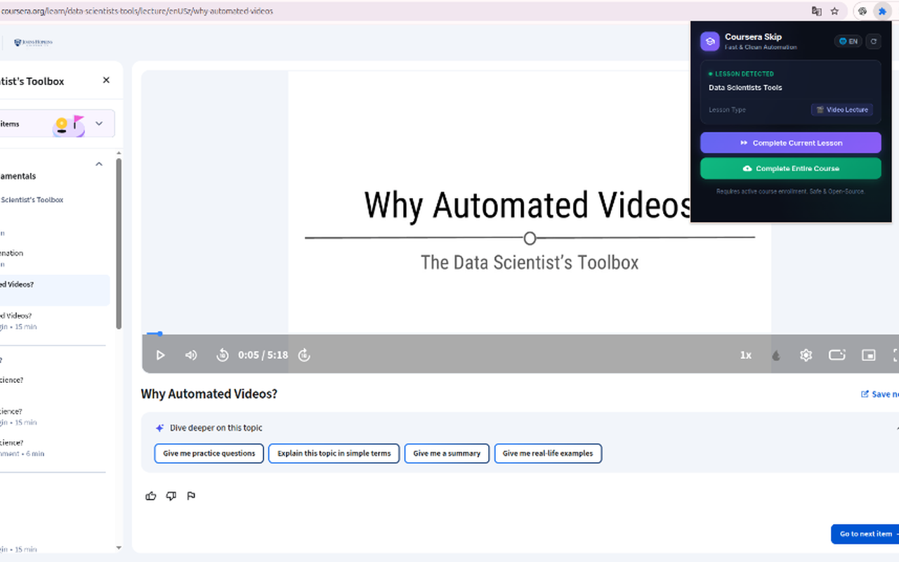

  <h1>🚀 Coursera Automation Tool (Clean & Safe)</h1>
  
<strong>A 100% safe, open-source browser extension to automate Coursera tasks. Skip videos, complete readings, and save time efficiently without any malicious code.</strong>

  
  
  
  
  

  

  <em>Live detection on active Coursera lecture with 1-click completion</em>

## 🌟 Introduction

This is the **completely safe, clean-rebuilt version** of the popular Coursera Automation / Skip extensions.

Unlike other versions circulating online that may contain harmful code (cookie stealing, data exfiltration), this repository provides a **transparent, from-scratch rewrite**. There are absolutely no hidden scripts, no remote tracking, and no cookie exfiltration. This tool is built by the community, for the community, ensuring your privacy and security.

## ✨ Features

- **📌 In-Page Floating Widget (v1.4.0+):** An always-available floating widget injected directly into Coursera course pages via Shadow DOM. Never gets closed or interrupted when clicking outside. Features a draggable header, collapsible FAB badge (`⚡`), and remembers its position and state in `localStorage`.
- **⚡ Complete Current Lesson:** Instantly mark the currently opened Coursera video lecture or reading material as completed.
- **🚀 Complete All Video & Reading (Bulk):** Automatically detect, batch-process, and complete all video lectures and reading items across the entire course.
- **💬 Complete All Discussions:** Batch-completes all mandatory discussion prompts across the course with rate-limit protection and automated response posting.
- **👥 Auto Peer Review:** 1-Click grading for peer-reviewed assignments. Selects rubric scores, inputs constructive positive feedback, and assists in completing reviews.
- **🤖 AI Study Assistant (Optional - v1.5.0):** Powered by Google Gemini 2.0 Flash (BYOK - Bring Your Own Key). Your personal API key is stored strictly on your local browser and never sent to any intermediate server.
- **⭐ Smart Review & Rating:** Easily support the project with a 5-star rating directly from within the extension.
- **🌐 Internationalization (i18n):** Full support for **English** and **Vietnamese (Tiếng Việt)** with a 1-click switcher `[🌐 EN | VI]` in both the floating widget and popup.
- **✨ Clean & Friendly UI/UX:** Streamlined dark theme with zero clutter, clean course name formatting, and an intuitive 3-step guide screen.
- **🔒 100% Secure & Open-Source:** Fully transparent code. No credential harvesting.

## 🛠 Installation Guide

### Option 1: Official Chrome Web Store (Recommended - 1 Click)
👉 **[Click here to Install from Chrome Web Store](https://chromewebstore.google.com/detail/coursera-skip-video-read/jjbgneddmjkolgmpamecbhfgjgdiajlf)**

> [!NOTE]
> **Why do I see "Proceed with caution"?**  
> As a newly verified developer account, Chrome Enhanced Safe Browsing displays this precautionary prompt for all new extensions. Simply click **"Continue to install"**. Our entire extension is 100% open-source and publicly auditable here!

---

### Option 2: Manual Developer Mode (From Source)
1. Clone or download this repository as a `.zip` file and extract it.
2. Open your Chromium-based browser (Chrome, Edge, Brave, Opera, Arc) and navigate to `chrome://extensions/`.
3. Enable **Developer mode** in the top-right corner.
4. Click the **Load unpacked** button.
5. Select the **`coursera-skip-tool` folder** containing `manifest.json`.
6. 🎉 You're all set!

## 📖 How to Use (Step-by-Step)

1. **Enroll** in your desired Coursera course.
2. **Open any page** in your course (e.g. `https://www.coursera.org/learn/{courseSlug}/...`).
3. **Use either the In-Page Floating Widget or the Toolbar Extension Popup:**
   - 📌 **In-Page Floating Widget**: Automatically appears in the bottom-right corner of any Coursera course page. You can drag it by the header, minimize it into a floating `⚡` badge, or keep it open while reading. Clicks elsewhere on the page will never interrupt its background operations!
   - 🧩 **Extension Popup**: Or click the extension icon in your browser toolbar anytime.
4. **Choose your desired automation action:**
   - ⚡ **Complete Current Lesson**: Instantly marks the active video, reading material, or discussion prompt as finished.
   - 🚀 **Complete All Video & Reading**: Batch processes and completes all video lectures & reading items across the entire course.
   - 💬 **Complete All Discussions**: Scans all discussion prompt assignments in the course and posts natural responses automatically.
   - 👥 **Auto Grade Peer Review**: When viewing a peer assignment, automatically grades with full marks and polite constructive feedback.
5. 🌐 **Language Switcher**: Click `[VI / EN]` anytime to switch interface language.

## ❓ Frequently Asked Questions (FAQ)

<strong>Q: Why does the extension show "Ready to Automate / Follow 3 steps" instead of the complete buttons?</strong>

 
The extension is designed to only activate when you are viewing an actual lesson page (such as a <strong>Video Lecture</strong> or <strong>Reading Material</strong>). Simply click into any lecture or reading item in your enrolled course, and open the extension popup again!

<strong>Q: Why do I see a 403 / 401 Permission Error?</strong>

 
Please make sure you are actively logged in and <strong>enrolled</strong> in the course on Coursera before running the tool.

## 💖 Support & Donate

This project is 100% free and open-source. If it saved your valuable time, consider supporting the developer:

- ⭐ **Star this repository** on GitHub!
- ☕ **Buy me a coffee**: [buymeacoffee.com/tuankiet](https://www.buymeacoffee.com) *(or via GitHub Sponsors)*
- 📢 **Share with fellow students** on Reddit (`r/coursera`, `r/learnprogramming`), Discord, or student groups.

## 🤝 Contributing

Contributions of all kinds are welcome! Whether you are fixing a bug, adding a new language translation, or improving the documentation:

1. Check out our **[Contributing Guidelines (CONTRIBUTING.md)](./CONTRIBUTING.md)** for local development setup, code structure, and guidelines.
2. Feel free to open an [Issue](https://github.com/tuankiet18-dev/coursera-skip-tool/issues) or submit a [Pull Request](https://github.com/tuankiet18-dev/coursera-skip-tool/pulls).

## ⚖️ Legal Disclaimer & Terms of Use

> [!IMPORTANT]
> 1. **Non-Affiliation:** This extension is an independent, community-driven open-source project and is **NOT affiliated with, associated with, authorized by, sponsored by, or endorsed by Coursera Inc.** Coursera and related marks are registered trademarks of Coursera Inc.
> 2. **Purpose of Software:** This software is provided strictly for educational research, study progress management, and personal productivity purposes.
> 3. **Honor Code & Compliance:** Users are solely responsible for ensuring their usage complies with [Coursera's Terms of Use](https://www.coursera.org/about/terms) and [Honor Code](https://www.coursera.org/about/terms/honorcode). The developers and contributors do not encourage academic dishonesty.
> 4. **No Warranty ("AS IS"):** As specified in the [MIT License](./LICENSE), this software is provided "AS IS", without warranty of any kind. The authors and contributors shall not be held liable for any claims, damages, account penalties, or course status changes resulting from the use of this tool. Use responsibly and at your own discretion.
